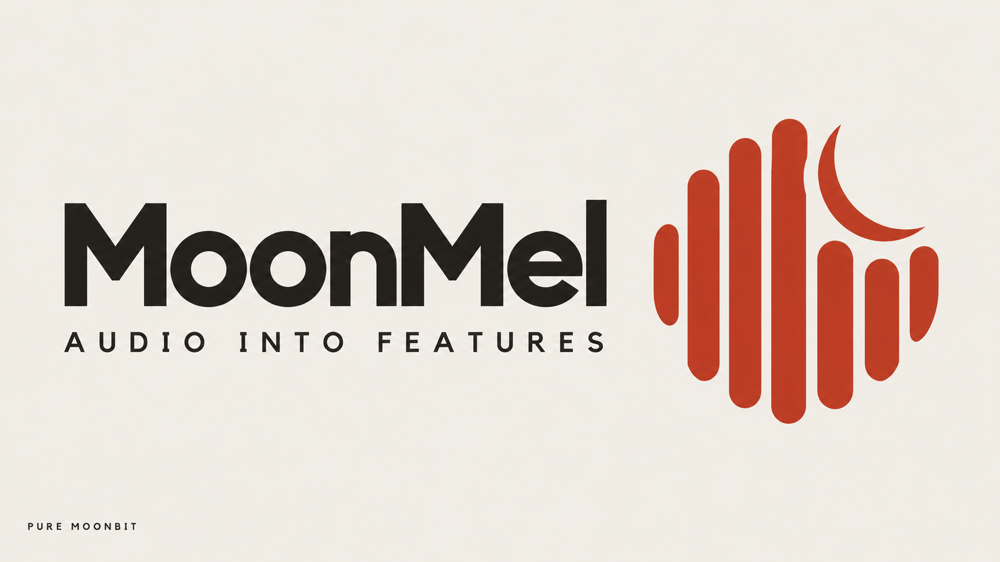

# MoonMel 设计系统

面向可检查音频特征的暖象牙白仪表界面。

<a href="DESIGN.md">English</a> · <a href="README_zh.md#从源码运行">从源码运行</a> · <a href="docs/zh/API_SPECIFICATION.md">接口规范</a> · <a href="docs/zh/ARCHITECTURE.md">架构</a>

## 总览

**创意北极星：“声学实验台”**

MoonMel 将温暖的印刷式品牌与精确的音频实验台结合。象牙白是连续的页面底色，炭黑承载阅读，朱砂红标记操作、重点和声条／月牙徽记。定制字标保留在规范品牌图像中。界面通过克制的字体、开放分区和细分隔线，让实际分析结果容易检查。

深色频谱是浅色品牌内部的工作数据区域。热图、坐标、逐帧数值和表格用于解释计算结果。动效限于按钮颜色短过渡和锚点滚动，并提供减少动态效果的覆盖规则。本文记录已经实现的系统；实验台的具体页面编排见[页面简报](.impeccable/surfaces/playground.md)。

**主要特征：**
- 暖象牙白底色、炭黑阅读文字和单一朱砂红品牌强调色。
- 规范声条／月牙徽记与定制栅格字标。
- 开放分区、细分隔线与轻微圆角控件。
- 无平滑的数据热图、明确单位和逐帧读数。
- 本机测量与限定范围的验证依据紧邻适用边界。

## 色彩

色彩温暖、哑光。数据强度使用连续暖色阶，不构成第二套品牌强调色。文件开头的结构化令牌是规范值，来源为[当前样式表](playground/src/style.css)。

### 主色

朱砂红用于重新计算、文字操作链接、选中强调、验证摘要和焦点轮廓。更深的朱砂红用于主按钮悬停。视图选中项使用暖色底和较深红色文字；最终评审记录该特定组合的文字对比度为（5.64:1）。

### 中性色

象牙白构成页面背景，炭黑为默认文字。柔和的深灰棕色用于标签、说明和测量值。字段背景轻微区分原生控件，细线划分区域。选中底色、对比列底色和代码底色提供局部层次；对比列与代码文字使用各自较深的暖色。深色画布底仅用于频谱。

CSS 变量名保留了历史命名：`--ink` 实际提供象牙白，`--paper` 实际提供炭黑。扩展源码时应保持真实赋值；结构化令牌采用描述性名称说明角色。`tailwind.config.js` 中未使用的深色调色板和 Inter／JetBrains 字体栈不代表当前可见界面。

**数据着色规则。** 热图颜色必须对应当前矩阵和显示范围。实现中的五个色阶节点由深炭黑经过暖红、琥珀色到浅象牙色；Log-Mel 与 STFT 使用相对分贝跨度（80 dB），MFCC 使用观测到的系数范围。恒定静音保持深色。sidecar 中合成的色阶仅用于令牌预览，不是新增的已部署颜色令牌，也不是热图色阶。

## 字体

**标题与正文字体：** 本地打包的 Manrope Variable，后备字体为 Microsoft YaHei 和系统无衬线字体。中文字符取决于实际可用的后备字体，不能宣称由 Manrope 提供。

**测量字体：** 系统等宽字体，后备为 Consolas 和通用等宽字体；没有单独下载等宽字体。

**字体性格：** 紧凑、安静的界面字体与有表现力的图像字标并置。定制字标不能用正文字体重打来替代。

### 层级

展示标题用于差异与证据分区。实验台标题刻意较小（22px），字距更紧（-0.025em）。次级标题用于开发者入口。正文负责阅读说明，引言稍大（桌面 20px；中间断点 17px）。标签说明原生字段；测量值采用等宽数字。代码使用等宽字体（12px／1.9），坐标说明使用更小的等宽字体（10px）。

**测量字体规则。** 代码、维度、参数和测量值使用等宽字体；叙述和导航使用无衬线字体栈。

## 布局

桌面阅读容器最大宽度为（1240px），左右总留白为（80px）。视口宽度不超过（900px）时，总留白改为（40px）；不超过（640px）时改为（32px）。开头的间距令牌记录重复出现的值，不代表新增 CSS 令牌接口。

界面使用连续分区和对齐列。当前桌面实验台由窄控制栏（245px；中间断点 210px）和可伸缩结果区组成。移动端视觉上先显示结果，再显示控件；参数区改为三列。HTML 中表单仍在结果前，因此视觉重排不改变键盘或辅助技术的阅读顺序。

竞品表保留最小宽度（930px），通过局部横向滚动展示。视口不超过（900px）时显示滚动提示，对比区域可获得键盘焦点。证据区和开发者入口在移动端改为单列。说明、单位、边界条件和下载入口应跟随其结果。

**结果优先规则。** 保留实验台移动端已经实现的“结果在控件之前”视觉顺序，让计算产物出现在详细配置之前。

## 层次与深度

界面没有盒阴影。层次来自象牙白、稍亮的字段、暖色选中区或代码区、细线以及深色数据画布。品牌横幅使用正片叠底混入页面；栅格图像的材料感属于品牌图像，不是界面悬浮效果。

**平面仪表规则。** 控件和数据区保持平面，通过色彩、边框和可见焦点轮廓表达交互状态。

## 形状

控件使用唯一的轻微圆角尺度。表格、分区边界、代码面板和数据画布保持矩形。分隔线和控件边框均为细线（1px）。胶囊状声条与月牙是规范品牌几何，不意味着导航和控件都应做成胶囊形。

规范图像为 [docs/banner.png](docs/banner.png) 和 [docs/logo.png](docs/logo.png)。实验台使用 [brand-banner.webp](playground/public/brand-banner.webp) 和公开目录中的 PNG 徽记。保持图像比例：横幅原图为（1672 × 941），页头徽记显示为（36 × 36）。使用现成的定制字标，避免用文字近似重建。

## 组件

### 按钮

操作按钮紧凑、轻微圆角。主操作使用朱砂红底和象牙白文字；播放、麦克风和导出等次级操作使用透明底和细边框。标准控件最小高度为（42px），导出按钮较小（34px）。悬停改变填充和边框，颜色过渡为（.18s）。焦点使用朱砂红轮廓（2px），偏移（4px）。禁用操作降低不透明度（.45），取消悬停填充；播放和导出仅在当前结果就绪后启用。

### 特征视图切换

Log-Mel、STFT 和 MFCC 是一组按钮。选中项使用暖底色和较深红色文字，以 `aria-pressed` 表达状态。最小高度为（36px）。切换视图重新绘制已经计算的结果；改变信号或分析参数才请求新的分析。

### 输入字段

原生选择框采用稍亮底色、细边框和共同圆角。文件字段保留浏览器选择器，仅对其按钮做样式处理；应保持文件控件的可识别性。WAV 和麦克风输入会禁用合成采样率与时长。来源身份、时长和采样率一起显示。WAV 加载使用独立输入修订号，防止解码期间修改分析参数导致所选文件被静默丢弃。错误文字紧邻控件，并通过警告区域呈现。

### 导航

小字号文字直接链接到实验台、差异与证据区。页头由徽记与可读 MoonMel 名称组成，定制字标保留在横幅。移动端主导航换到独立一行。源码链接带细下划线，内容操作链接使用朱砂红与底部细线。键盘聚焦时显示跳到实验台的链接。当前没有随滚动跟踪活动分区的逻辑。

### 容器与代码面板

开放分区是默认容器。控件／结果边界和开发者入口由细线界定；代码示例为平面暖色嵌入区，使用等宽文字并支持横向溢出。MoonMel 对比列使用暖色底和较深文字，竞品列通过横向滚动保持可访问。当前页面没有可复用的营销卡片系统。

### 音频图与验证依据

频谱为矩形画布，矩阵像素清晰，低频在下，时间向右增长。三个布局阶段的高度分别为（330px）、（290px）和（230px）。指针移动或左右方向键选择时间帧并更新文字读数。波形和可展开的滤波器组来自同一次真实输入／分析。画布的可访问名称、说明和帧读数补充图像信息；这不意味着获得全面无障碍认证。

界面明确标识运行路径为 MoonBit 生成的 JavaScript 和 Web Worker。WASM 与原生是库的编译目标。显示耗时是当前设备上的 Worker 测量，包含计时范围内的转换／序列化工作，不包含端到端绘制，也不能用于竞品排名。参考表来自仓库中的报告：八组确定性配置，对齐反射填充、周期 Hann、float64 Slaney 和正交 DCT-II。Mel／Log-Mel／MFCC 比较完整矩阵；STFT 每帧最多比较 64 个明确索引的频点。这些结果不代表整个库与 librosa、Meyda 或 Essentia.js 等价。

本文已与源码、规范品牌图像及 `.impeccable/review/` 中最终桌面（1440 × 2925）和移动（390 × 4097）截图核对。评审交接记录五项问题已修复：WAV 加载身份、静音深色、移动端结果顺序、表格滚动提示和选中项对比度。限定范围内结论为可交付；这不表示所有浏览器已覆盖、性能领先或所有特征均完成外部验证。

配套 [.impeccable/design.json](.impeccable/design.json) 使用 schemaVersion 2，包含扩展元数据、八个独立组件预览以及英文主文档的叙述；基础令牌仍由文档开头定义。预览标签和色带是组件示例，不是音频测量结果。

## 应做与避免

### 应做：
- **应**保留规范声条／月牙图像与定制字标。
- **应**让整体页面保持象牙白，工作频谱保持深炭黑。
- **应**让单位、来源、帧读数与验证边界紧邻结果。
- **应**保留可见焦点、移动端表格滚动提示和选中项对比度。
- **应**将当前浏览器引擎表述为 Web Worker 中的生成 JavaScript。

### 避免：
- **避免**用 Tailwind 配置中未使用的深色主题替换当前可见系统。
- **避免**在现有开放、平面仪表界面中添加装饰卡片堆叠或阴影。
- **避免**把恒定静音提亮成看似存在的信号能量。
- **避免**将八组限定配置的参考结果扩展成全库等价宣称。
- **避免**用本机执行时间虚构竞品速度、体积或质量排名。
