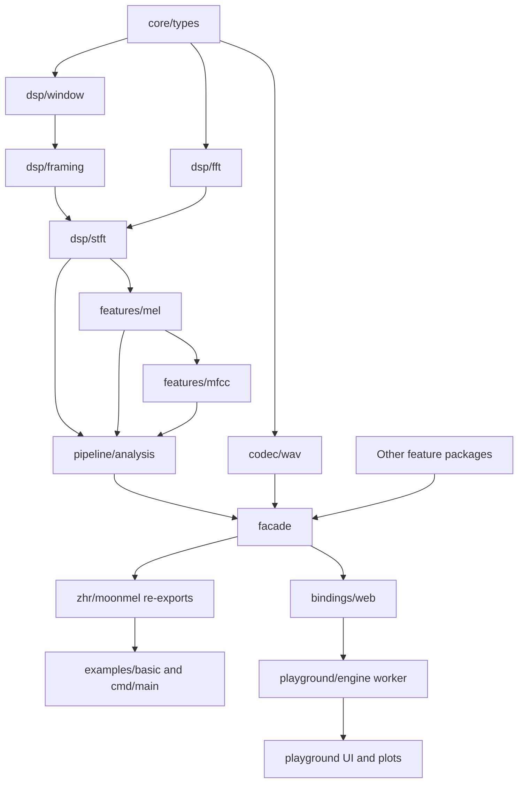

# Architecture

[中文](../zh/ARCHITECTURE.md)

## Dependency direction

Arrows indicate data/API provision toward consumers. The machine-checked dependency graph uses the inverse import relation: `node tools/quality/check-architecture.mjs` rejects cycles and dependencies into a higher layer. Core types have no internal project imports. Same-layer feature dependencies are permitted; no DSP package may import a feature, pipeline or facade package.

| Layer | Packages / responsibility | Contract |
| --- | --- | --- |
| Core | `core/types`: errors, audio, config, matrix, complex files | Own data and validation, no algorithm orchestration |
| DSP and codec | Windows, framing, FFT, STFT, filters, resampling, WAV | Transform signals and parse bounded bytes |
| Features | Mel/MFCC and other feature families | Depend on DSP or other lower/same-layer features |
| Pipeline | `pipeline/analysis` | One STFT and one filterbank, then ordered derived features |
| Facade and bindings | `facade`, root re-exports, `bindings/web` | Ergonomic adapters and JSON transport; no copied DSP algorithms |

## Shared analysis

`AnalysisResult` contains STFT, filterbank, Mel, Log-Mel and MFCC. Standalone feature calls remain compatible. Matrix-taking `mel.apply_filterbank`, `mel.mel_from_spectrogram`, `mfcc.log_mel_from_mel` and `mfcc.mfcc_from_log_mel` permit reuse without a second STFT. The DCT basis is computed once per matrix rather than once per frame.

`framing.window_frame` puts a short window at `(n_fft - win_length) / 2` in a complete FFT frame and reads samples at that same offset. Offline and streaming framing share this implementation. STFT reuses real/imaginary buffers; arbitrary lengths dispatch to Bluestein and allocate its temporary arrays. The raw radix-2 kernel has strict power-of-two and buffer-length preconditions.

## Matrix ownership and errors

Feature matrices store mutable rows with explicit dimensions. `validate()` checks dimensions and ragged rows at reusable stage boundaries; the low-level `at`/`set` operations assume valid indices. `Result[T, MelError]` carries public high-level failures. Config validation covers positive dimensions, window size, finite numerical parameters and frequency bounds. The web boundary returns `success:false` and safely escaped JSON for errors.

WAV parsing checks the declared RIFF container and each payload before indexing; format/layout consistency and complete PCM frames are required. Negative signed representations of hostile unsigned lengths are rejected. Data may precede format; duplicate data/format chunks are rejected.

## Streaming semantics

Streaming analyzes left-aligned complete FFT frames and ignores `config.center`; it does not synthesize offline reflection boundaries or flush an incomplete tail. A buffer cursor preserves gaps for `hop_length > n_fft`. FFT/window/filterbank storage is reused, but output matrices, buffer growth/compaction and Bluestein transforms allocate. MFCC log options and DCT normalization are honored. Decibel `top_db` clipping is relative to each emitted matrix, so independently emitted batches are not globally normalized like a single offline matrix.

## Browser architecture

`domain/signals` owns synthetic data and preview limits; `engine` owns request correlation, worker lifetime and the binding; `audio` owns playback and AudioWorklet capture; `render` owns plots and evidence; `main` coordinates DOM state. Source-loading identity is separate from analysis revisions, so parameter changes during file loading cannot discard the file. Synthetic rate changes do not reinterpret uploaded PCM. Microphone requests are throttled and numerical work does not block rendering.

Generated JS is ignored and regenerated by `tools/build/sync-web.mjs` before dev/build. The demo honestly labels JavaScript execution. Its microphone is a rolling offline preview, not an incremental streaming API demonstration.

Browser transport declares only JS/WASM/WASM-GC support so Native builds do not try linking a browser foreign library as an executable. The core library and examples support Native.
