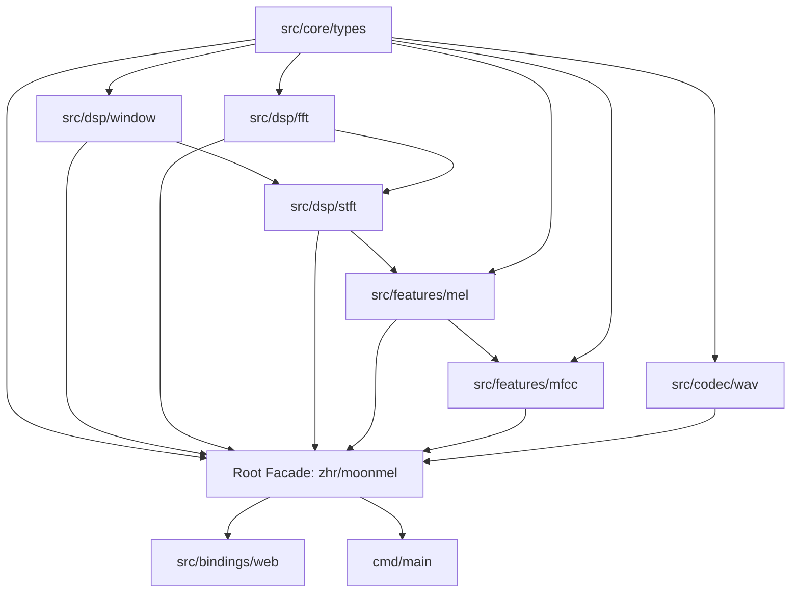

# MoonMel Architecture & System Design

[English](./ARCHITECTURE.md) | [中文说明](../zh/ARCHITECTURE.md)

This document describes the layered package topology, memory model, and error propagation invariants of MoonMel.

---

## 1. Architectural Philosophy

1. **Anti-Flat Hierarchy**: Rejects cluttered single-folder structures in favor of distinct, focused subpackages.
2. **Directed Acyclic Graph (DAG)**: Strict single-direction dependency flow prevents cyclic couplings.
3. **Pure MoonBit Core**: Zero C library wrappers ensures uniform behavior across WebAssembly, JavaScript, and Native targets.
4. **Ergonomic Facade**: The root module re-exports common functionality while preserving direct access to fine-grained subpackages.

---

## 2. Package Topology

### Subpackage Responsibilities

| Package Path | Core Responsibility | Internal Dependencies |
| :--- | :--- | :--- |
| `src/core/types` | Data models, complex arithmetic, configuration, error types | None (Zero internal dependencies) |
| `src/dsp/window` | Window functions, boundary reflect padding | `src/core/types` |
| `src/dsp/fft` | In-place Radix-2 Cooley-Tukey FFT, bit-reversal | `src/core/types` |
| `src/dsp/stft` | STFT framing, power spectrum, complex spectrogram | `src/core/types`, `src/dsp/window`, `src/dsp/fft` |
| `src/features/mel` | Slaney/HTK Mel scales, filterbank generation, Mel projection | `src/core/types`, `src/dsp/stft` |
| `src/features/mfcc` | Power-to-dB conversion, Log-Mel, DCT-II ortho, MFCC | `src/core/types`, `src/features/mel` |
| `src/codec/wav` | RIFF PCM WAV parser and stereo-to-mono downmixing | `src/core/types` |
| `src/bindings/web`| WebAssembly / JavaScript JSON bridge | Root facade `zhr/moonmel` |
| Root Facade | Unified top-level API re-exports | All internal modules |

---

## 3. Memory & Performance Strategy

- **In-place Butterfly FFT**: Eliminates intermediate allocations during recursion stages, drastically minimizing WebAssembly garbage collection overhead.
- **Preallocated Buffers**: Frame-by-frame STFT computations reuse preallocated real/imaginary buffers.
- **Row-Major FeatureMatrix**: Features are stored in structured 2D matrices supporting efficient element access, slicing, and flattening.

---

## 4. Error Handling Model

MoonMel relies exclusively on `Result[T, MelError]` for predictable error propagation:
- `EmptyAudio`: Input buffer contains no samples.
- `InvalidSampleRate(Int)`: Sample rate is non-positive.
- `InvalidFftSize(Int)`: FFT size is non-positive or not a power of two.
- `InvalidHopLength(Int)`: Hop length is non-positive.
- `InvalidMelBands(Int)`: Mel band count is non-positive.
- `InvalidFrequencyRange(Double, Double)`: Frequency bounds are invalid or exceed Nyquist.
- `DimensionMismatch(String)`: Mismatched time or frequency dimensions.
- `WavParseError(String)`: Malformed WAV header or unsupported format.
