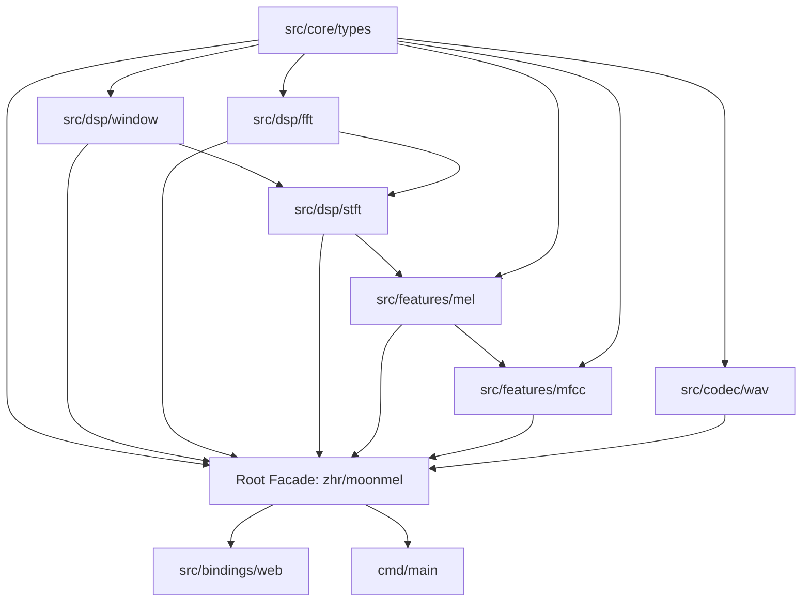

# MoonMel 架构设计文档 (Architecture)

[English](../en/ARCHITECTURE.md) | [中文说明](./ARCHITECTURE.md)

本文档阐述 MoonMel 项目的低耦合分层架构、包拓扑依赖规则、内存管理策略与错误处理模型。

---

## 1. 设计哲学与核心原则

1. **拒绝扁平单目录**：严格遵循分层解耦架构，严禁将所有数据结构、数学运算、特征算子平铺在根目录。
2. **单向无环依赖 (DAG)**：底层核心模型不依赖上层算法，DSP 变换层仅依赖数据类型与数学标准库。
3. **零外部原生依赖**：所有矩阵操作、复数运算、窗函数与编解码器均为纯 MoonBit 代码，保证 WASM、JS 与 Native 平台行为完全同一。
4. **高层门面 (Facade) 极简接入**：根包作为 Ergonomic Facade，通过统一重导出降低终端使用者集成心智负担。

---

## 2. 模块分层与依赖拓扑

### 包依赖规则矩阵

| 包路径 | 职责定位 | 允许导入的内部依赖 |
| :--- | :--- | :--- |
| `src/core/types` | 基础几何模型、复数、矩阵、配置与错误 | **无内部依赖**（零内部耦合） |
| `src/dsp/window` | 窗函数计算、索引反射填充 | `src/core/types` |
| `src/dsp/fft` | 快速傅里叶变换内核、位反转置换 | `src/core/types` |
| `src/dsp/stft` | 分帧加窗短时傅里叶变换、单边功率谱 | `src/core/types`, `src/dsp/window`, `src/dsp/fft` |
| `src/features/mel` | Mel 频率映射、三角滤波器组、Mel 谱投影 | `src/core/types`, `src/dsp/stft` |
| `src/features/mfcc` | 对数压缩、DCT-II 正交变换、MFCC 系数 | `src/core/types`, `src/features/mel` |
| `src/codec/wav` | RIFF PCM WAV 格式解析与多声道混音 | `src/core/types` |
| `src/bindings/web`| WebAssembly / JS 浏览器 JSON 桥接层 | 根包 `zhr/moonmel` |
| 根包（Facade） | 统一公共 API 门面与类型重导出 | 所有底层核心模块 |

---

## 3. 内存管理与连续存储设计

- **原地 FFT (In-place Butterfly)**：FFT 核心计算在预分配的实部与虚部缓存数组中进行原地交换与迭代蝶形运算，分帧计算时复用 `frame_buf`，杜绝递归分支产生的海量小数组分配与 WASM GC 停顿。
- **二维矩阵包装 (FeatureMatrix)**：以一维外层向量组织连续帧数据，提供 `at(row, col)` 与 `set(row, col, val)` 规整访问，支持高效矩阵转置与一维线性扁平化导出。

---

## 4. 异常与错误传递模型

MoonMel 摒弃无意义的隐式崩溃或静默误处理，定义强类型 `MelError`：
- `EmptyAudio`：音频采样流为空。
- `InvalidSampleRate(Int)`：非正采样率。
- `InvalidFftSize(Int)`：非 2 的幂次或非正 FFT 大小。
- `InvalidHopLength(Int)`：非正帧移步长。
- `InvalidMelBands(Int)`：非正 Mel 频带数量。
- `InvalidFrequencyRange(Double, Double)`：截止频率超出奈奎斯特频率或区间倒置。
- `DimensionMismatch(String)`：时频维度不匹配。
- `WavParseError(String)`：WAV 文件头校验失败或不支持的编码格式。

所有计算管道采用 MoonBit `Result[T, MelError]` 进行强确定性错误传播。
